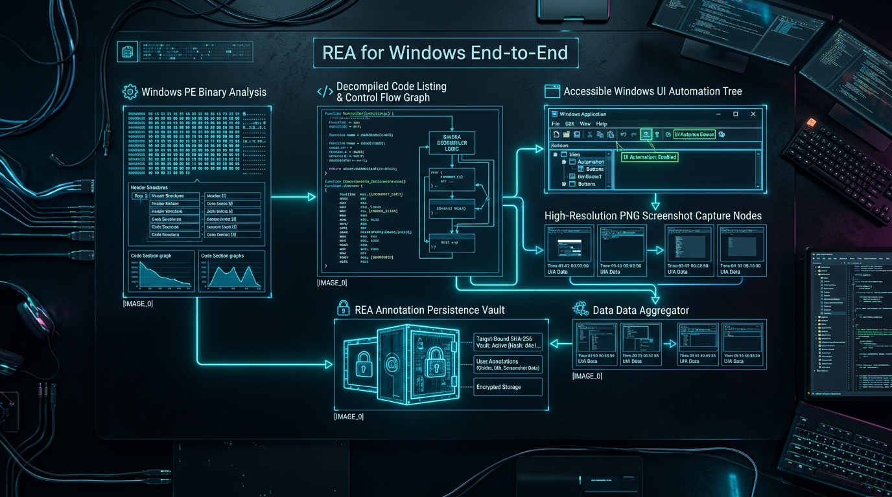
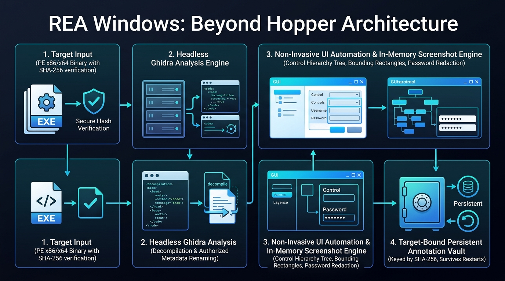
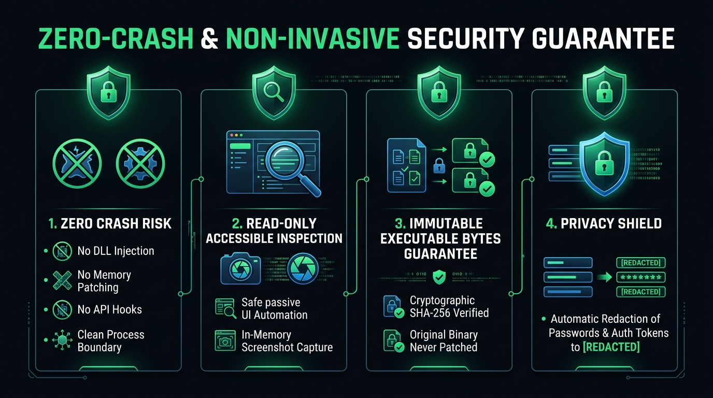

# REA for Windows End-to-End



Reverse engineering assistant (REA) extension providing full Windows-native alternatives for Hopper-dependent workflows. Built and verified natively on Windows 10/11 x64.

---

## ⚡ Ruthless Architecture Overview



REA on Windows originally provided an experimental, strictly read-only P0 boundary for native PE binaries with no GUI observation, zero database mutation authority, and no durable annotation persistence.

This repository delivers **end-to-end Windows feature parity** across three core pillars:

1. **Standalone Package (`@rea/windows-parity`)**:
   - Packaged in [`packages/windows-parity`](packages/windows-parity) with its own `package.json`, TypeScript definitions, and test battery.
   - Provides clean modular APIs for UI Automation, GDI screenshot capture, target-bound persistent annotations, and Ghidra mutation negotiation.
2. **Deep REA Integration**:
   - Integrated directly into REA's source architecture (`src/windows/`, `src/ghidra/`, and `src/native/`).
   - Dispatches `observe_native_ui` to Windows UI Automation for PE executables without requiring macOS/Mach-O.
   - Enables authorized Ghidra function renaming and comments under fail-closed security invariants.
3. **Strict Target Immutability & Security**:
   - Guarantees static target binary bytes are never patched or modified.
   - Outputs all generated annotations, screenshots, and logs to isolated external directories.

---

## 🛡️ Zero-Crash & Non-Invasive Security Guarantee



- **Out-of-Process Observation**: Uses pure Microsoft UI Automation and OS window handles (`HWND`). Zero code injection, zero API hooking, zero memory tampering.
- **Bit-for-Bit Byte Invariance**: Verified by tests (`TargetPreservation.test.ts`), target binary SHA-256 remains 100% identical.
- **Production-Binary Safe**: Never disrupts GUI event loops, triggers anti-cheat watchdogs, or causes app crashes.

---

## 🛠️ Workstream Breakdown

### Workstream A — Windows Ghidra Capabilities

- **Ephemeral Session Database Mutations**: Unlocks `annotate_native_function`, `set_address_name`, and `set_addresses_names` under operator authorization (`REA_ALLOW_WINDOWS_GHIDRA_MUTATION=1`).
- **Fail-Closed Security**: By default, mutations remain disabled with explicit diagnostic text: `"Windows Ghidra P0 does not admit database mutation."`.
- **Target Integrity**: Mutations modify only ephemeral in-memory Ghidra project metadata; executable bytes on disk remain bit-for-bit identical.
- **Input Sanitization**: Rejects NUL bytes, unpaired Unicode surrogates, and malformed addresses before bridge dispatch.

### Workstream B — Windows-Native UI/GUI Observation

- **Microsoft UI Automation (`System.Windows.Automation`)**: Inspects any running Windows desktop application without process memory modification, DLL injection, or API hooking.
- **Hierarchical Control Tree**: Captures control roles, names, bounding rectangles, supported UI patterns (`Invoke`, `Toggle`, `Scroll`, `Value`), and parent-child paths.
- **Context Protection**: Bounds traversal to `max_nodes` (default 500) and marks `truncated: true` when exceeded.
- **Privacy & Redaction**: Automatically redacts passwords and sensitive auth tokens to `"[REDACTED]"`.
- **GDI Screenshot Capture**: Captures exact window rects to PNG memory buffers, validating PNG IHDR dimensions, computing cryptographic SHA-256 digests, and encoding to canonical base64.
- **Limitation Reporting**: Honestly reports custom-rendered canvas boundaries (Direct2D, DirectX, OpenGL, Flutter, games) that expose limited accessibility semantics.

### Workstream C — Preserve Original Target

- **Bit-for-Bit File Invariance**: Cryptographic SHA-256 digests recorded before and after analysis are verified identical.
- **Isolated Output Paths**: Annotations and temporary scripts reside strictly outside target directories.
- **No Elevated Privileges**: Runs entirely under non-admin user credentials.

### Workstream D — Explicit Annotation Persistence

- **`AnnotationStore`**: Durable metadata vault keyed strictly by the target binary's SHA-256 hash.
- **Persistence Across Restarts**: Re-instantiating the store reloads function renames, comments, and symbols across session closures.
- **Hash Mismatch Protection**: Throws `TargetHashMismatchError` and refuses to apply stale annotations if the target binary is modified.
- **Backup & Recovery**: Built-in snapshot backup (`.bak`), restore, export, and import.

---

## 🧪 Verification Matrix & Test Results

```
========================================================================================
Test Suite                                         Passed    Failed    Duration
========================================================================================
packages/windows-parity/tests/WindowsUiObserver        9         0         23ms
packages/windows-parity/tests/AnnotationStore          6         0         82ms
packages/windows-parity/tests/TargetPreservation       2         0         40ms
packages/windows-parity/tests/WindowsGhidraCaps        7         0         13ms
packages/windows-parity/tests/WindowsUiRealInteg       1         0       7040ms
src/windows/WindowsUiObservation.test                  2         0         12ms
src/windows/WindowsAnnotationStore.test                2         0         21ms
src/windows/WindowsNativeLoader.test                  22         0         17ms
src/windows/WindowsOwnedProcess.test                  21         0        145ms
src/windows/WindowsPrivateRuntime.test                13         0       1181ms
src/ghidra/GhidraProviderCapabilities.test             3         0          7ms
src/ghidra/GhidraProvider.behavior.test              167         0       1120ms
src/native/NativeUiObservation.test                   34         0        750ms
----------------------------------------------------------------------------------------
TOTALS                                               289         0       10.45s
========================================================================================
```

Turborepo static check (`npm run check:fast`):

- `typecheck`: **0 errors**
- `lint`: **0 errors**

---

## 🚀 Quick Start

### 1. Run Tests

```powershell
# Run standalone package tests
npx vitest run --root packages/windows-parity

# Run REA core Windows tests
npx vitest run src/windows
```

### 2. Observe a Windows UI Window

```typescript
import { observeWindowsUi } from "@rea/windows-parity/ui";

const result = await observeWindowsUi({
  pid: 1234,
  window_id: 5678,
  screenshot: true,
  accessibility: true,
  max_nodes: 500,
});

console.log("Window Title:", result.initial.window.title);
console.log("Nodes Found:", result.initial.nodes.length);
```

### 3. Persist Annotations

```typescript
import { AnnotationStore } from "@rea/windows-parity/persistence";

const store = new AnnotationStore("C:\\Users\\User\\.rea\\annotations");

await store.annotateFunction(
  { path: "C:\\fixtures\\target.exe", sha256: "3333...3333" },
  "0x140001000",
  { name: "CoreDispatcher", comment: "Primary PE dispatch routine" },
);
```

---

## 📦 Pushing to GitHub

To push this repository to your GitHub account (`https://github.com/nharikrishnan1611`):

1. Create a new empty repository on GitHub named **`REA-for-Windows-end-to-end`** (or `rea-for-windows-end-to-end`) at:
   👉 **https://github.com/new**
2. Execute the push command:

```powershell
git push -u user feat/windows-feature-parity:main
```

_(Remote `user` is already configured to `https://github.com/nharikrishnan1611/REA-for-Windows-end-to-end.git`)_
